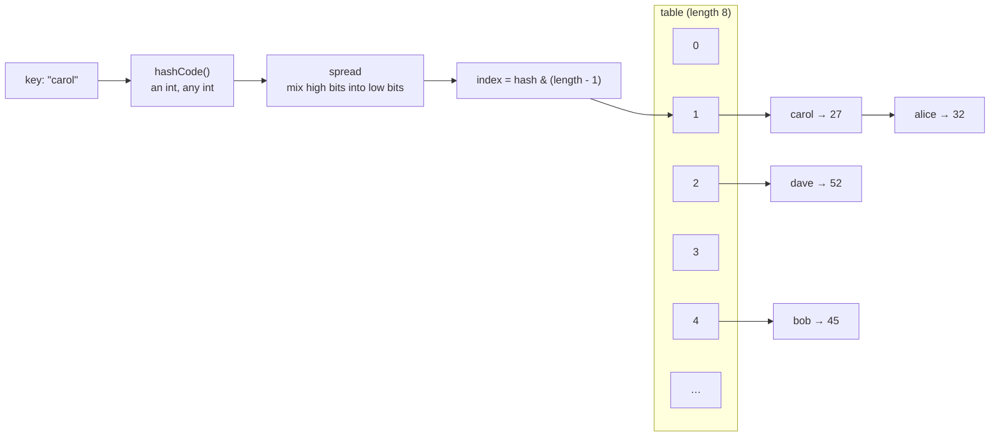
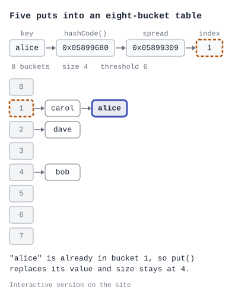
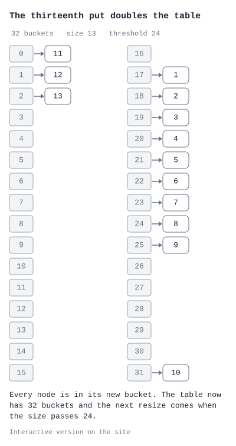
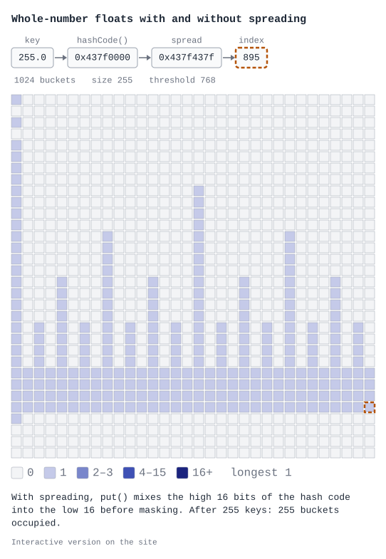

# Hash map: from a list of pairs to java.util.HashMap

By the end of this article you will have built a working hash map in about 250 lines of Java, and you will be able to open `java.util.HashMap` and explain why each of its odd-looking constants is there.

**Prerequisites:** arrays, linked lists, and Big-O notation. None of those have articles here yet; the [catalogue](../../../../../../../topics/data-structures.md) tracks them.

**Code for this article:** [`AssociationListMap.java`](AssociationListMap.java), [`ChainedHashMap.java`](ChainedHashMap.java), [`ChainedHashMapTest.java`](../../../../../test/java/learn/ds/hashmap/ChainedHashMapTest.java), [`SimpleMapProperties.java`](../../../../../test/java/learn/ds/hashmap/SimpleMapProperties.java).

## The problem that forces this to exist

A map answers one question: given a key, what is its value? The simplest thing that works is a list of pairs, searched from the front.

```java
private Pair<K, V> find(K key) {
  for (Pair<K, V> pair : pairs) {
    if (Objects.equals(pair.key, key)) {
      return pair;
    }
  }
  return null;
}
```

That is the whole of [`AssociationListMap`](AssociationListMap.java), and it is correct. It passes the same randomised test as the real hash map later in this article.

It breaks on cost, not correctness. Looking up a key that is not there has to compare against every pair. With 100,000 entries, one miss is 100,000 calls to `equals`. Building the map is worse: each `put` first searches for an existing key, so inserting n distinct keys costs about n²/2 comparisons. For 100,000 keys that is five billion.

Compare that with an array. `array[i]` costs the same whether the array has ten elements or ten million, because the position is computed, not searched for. So the question becomes: **can we compute where a key lives, instead of searching for it?**

A key is not an array index. But Java gives every object a method that turns it into an `int`: `hashCode()`. A hash map is what you get when you take that seriously.

## Mental model

A hash map is an array of short lists, plus a rule that tells you which list a key must be in.



The rule never says where the key *is*. It says where the key would have to be. That is enough: you only search one short list, and if the key is not in it, the key is not in the map.

## Build it from scratch

The finished class is [`ChainedHashMap`](ChainedHashMap.java). It took four steps to get there, and each one fixes something the previous step got wrong.

### Step 1: turn a hash code into a bucket

`hashCode()` can return any `int`, including negative ones. The table has, say, 16 slots. The obvious mapping is `hash % 16`, and it has a bug: in Java the remainder takes the sign of the left operand, so `-7 % 16` is `-7`, which is not a valid index.

If the table length is always a power of two, there is a better option:

```java
static int indexFor(int hash, int capacity) {
  return hash & (capacity - 1);
}
```

For a capacity of 16, `capacity - 1` is `1111` in binary, so the mask keeps the low four bits and throws the rest away. The result is always between 0 and 15, for negative hashes too, and it avoids a division. The test `maskingAgreesWithFloorModForNegativeHashes` pins this down.

This choice has a price, and it comes due in step 4.

### Step 2: two keys, one bucket

There are about four billion `int` values and far fewer buckets, so different keys will share a bucket. That is a **collision**, and it is normal, not an error. Each bucket therefore holds a linked list of nodes, and a lookup walks that list:

```java
private static boolean matches(Node<?, ?> node, int hash, Object key) {
  return node.hash == hash && Objects.equals(node.key, key);
}
```

Two details matter here.

Each node stores the key's hash, and `matches` compares hashes before calling `equals`. An `int` comparison is cheap and rules out almost every non-matching node, so `equals` (which for a long string walks the characters) usually runs once, on the node that actually matches.

The hash only narrows the search. **`equals` makes the decision.** The test `keysWithTheSameHashCodeStayDistinct` uses a key type whose `hashCode()` always returns 42. All three keys land in one bucket, and all three are still found correctly. A terrible hash function makes a hash map slow, never wrong.

The reverse does break it. If two objects are `equals` but return different hash codes, the map looks in the wrong bucket and reports the key missing. That is the reason for the rule that you must override `hashCode` whenever you override `equals`.



Watch `carol` land in the same bucket as `alice` and go in at the head of the chain, then watch the second `put("alice")` walk that chain, find the match and replace the value without adding a node.

### Step 3: grow before the lists get long

Stop here and you have built something that is still O(n). With 16 buckets and 100,000 entries, each list holds about 6,250 nodes. Sixteen times faster than the list of pairs, and still linear.

The fix is to keep the lists short by adding buckets as entries arrive. `ChainedHashMap` doubles the table when the entry count passes 75% of the table length:

```java
table[index] = new Node<>(hash, key, value, table[index]);
size++;
probe.linked(key, index);
if (size > threshold) {
  resize();
}
```

The `probe` call does nothing unless a test is listening; it is how the animations in this article were recorded from the real code.

Resizing visits every node and moves it to its bucket in the larger table. That single `put` costs O(n), which sounds like it brings back the original problem. It does not, because doubling makes resizes rare. Growing to n entries moves at most n + n/2 + n/4 + … nodes in total, which is less than 2n. Spread over the n insertions that caused them, that is a constant amount of extra work each. This is what "amortised O(1)" means: any single operation may be slow, but the average over a sequence is constant.



Watch the thirteenth entry push the size past the threshold of 12: during the resize every node either stays in its bucket or moves exactly 16 along, because the larger mask looks at one more bit of the hash.

`doublesWhenLoadFactorIsExceeded` checks the exact moment of growth (the 13th entry in a 16-bucket table), and `keepsEveryEntryAcrossManyResizes` starts from a single bucket and checks that 10,000 entries survive fourteen doublings.

### Step 4: pay the price from step 1

Masking only looks at the low bits of the hash. If a set of keys differs only in the high bits, every one of them gets the same index.

This is not hypothetical. `Float.hashCode()` returns the raw bits of the float, and for whole numbers the low bits are all zero:

| Key | `hashCode()` in hex |
|---|---|
| `1.0f` | `3f800000` |
| `2.0f` | `40000000` |
| `3.0f` | `40400000` |
| `255.0f` | `437f0000` |

In a table of 1,024 buckets, the mask keeps the low ten bits. All 255 of the whole-number floats from 1 to 255 land in bucket 0, and the map is a linked list again.

The repair is one line, applied before masking:

```java
int h = key.hashCode();
return h ^ (h >>> 16);
```

It XORs the top 16 bits into the bottom 16, so the high bits get a say in the index. The test `spreadingRescuesKeysThatDifferOnlyInTheirHighBits` measures both versions on those 255 keys: without spreading they occupy 1 bucket, with spreading they occupy 255.



On the site, step through the first half: without spreading, every key goes to bucket 0 and nothing else fills; in the second half the same keys, spread first, each get a bucket of their own.

## Invariants and complexity

These must hold after every operation. The property tests in [`SimpleMapProperties`](../../../../../test/java/learn/ds/hashmap/SimpleMapProperties.java) check the visible consequences by running random operation sequences against `java.util.HashMap` and requiring identical answers at every step.

- The table length is a power of two.
- Every node sits in bucket `indexFor(node.hash, table.length)`.
- No two nodes in the map have equal keys.
- `size` equals the number of nodes.
- `size` is at most `threshold` once `put` returns (until the table reaches its maximum length).

| Operation | Expected | Worst case |
|---|---|---|
| `get`, `containsKey`, `remove` | O(1) | O(n), all keys in one bucket |
| `put` | O(1) amortised | O(n), on a resize or with all keys in one bucket |
| Space | O(n) | between 1.3 and 2.7 table slots per entry, plus a node per entry |

"Expected" assumes the hash function spreads keys evenly. The worst case is not only bad luck: someone who controls the keys can choose ones that collide on purpose. The JDK's answer to that is the most interesting part of its implementation.

## In the wild: java.util.HashMap

Links are to OpenJDK at the `jdk-25-ga` tag: [`HashMap.java`](https://github.com/openjdk/jdk/blob/jdk-25-ga/src/java.base/share/classes/java/util/HashMap.java).

The core is the same design as above: an array of buckets, a power-of-two length, a mask for the index ([line 637](https://github.com/openjdk/jdk/blob/jdk-25-ga/src/java.base/share/classes/java/util/HashMap.java#L637)), the same XOR spreading ([lines 336 to 339](https://github.com/openjdk/jdk/blob/jdk-25-ga/src/java.base/share/classes/java/util/HashMap.java#L336-L339)), and a default load factor of 0.75 ([line 250](https://github.com/openjdk/jdk/blob/jdk-25-ga/src/java.base/share/classes/java/util/HashMap.java#L250)). The differences are where the engineering decisions show.

| Decision | Why | What it costs | Alternative not taken |
|---|---|---|---|
| Spread with a single XOR and shift | The comment calls it "the cheapest possible way to reduce systematic lossage". It runs on every operation, so it has to be nearly free. | It is a weak mixer. Keys can still collide badly. | A strong mixing function on every call. The JDK instead relies on trees (below) for the bad cases. |
| Load factor 0.75 | With random hashes, bucket sizes follow a Poisson distribution. The source lists the odds: about 61% of buckets empty, 30% with one node, and 8 nodes in a bucket at 0.00000006 ([lines 183 to 200](https://github.com/openjdk/jdk/blob/jdk-25-ga/src/java.base/share/classes/java/util/HashMap.java#L183-L200)). | Roughly half to two-thirds of the table slots are empty at any time. | A higher load factor saves memory and lengthens chains; a lower one does the opposite. |
| Allocate the table on first `put` | `new HashMap<>()` that never receives an entry allocates no array. Many maps in real programs stay empty. | `resize()` has to handle the "no table yet" case as well as growth ([line 684](https://github.com/openjdk/jdk/blob/jdk-25-ga/src/java.base/share/classes/java/util/HashMap.java#L684)). | Allocating in the constructor, as `ChainedHashMap` does. |
| Split each bucket in two on resize | When the table doubles, a node either stays at index `j` or moves to `j + oldCapacity`, decided by one bit: `(e.hash & oldCap) == 0` ([line 728](https://github.com/openjdk/jdk/blob/jdk-25-ga/src/java.base/share/classes/java/util/HashMap.java#L728)). The code builds a "lo" list and a "hi" list and keeps nodes in their original order. | More code than re-inserting each node. | Re-inserting at the head, as `ChainedHashMap` does, which reverses each chain on every resize. |
| Turn long chains into red-black trees | A bucket that already holds 8 nodes becomes a tree when another is added ([`TREEIFY_THRESHOLD`, line 260](https://github.com/openjdk/jdk/blob/jdk-25-ga/src/java.base/share/classes/java/util/HashMap.java#L260)), so a flooded bucket costs O(log n), not O(n). | Tree nodes are "about twice the size of regular nodes", and the class gains several hundred lines of tree code. | Leaving the worst case at O(n), or randomising the hash function per map. |

The tree decision deserves a closer look, because three constants work together.

**8 to treeify, 6 to untreeify.** A bucket becomes a tree when it grows past 8 nodes, and goes back to a list when a resize splits it down to 6 or fewer ([line 267](https://github.com/openjdk/jdk/blob/jdk-25-ga/src/java.base/share/classes/java/util/HashMap.java#L267)). The gap is deliberate. With a single threshold, a bucket hovering at the boundary would convert back and forth on alternating inserts and removes.

**Not below 64 buckets.** If a bucket hits 8 nodes while the table has fewer than 64 buckets, the map resizes and does not treeify ([line 764](https://github.com/openjdk/jdk/blob/jdk-25-ga/src/java.base/share/classes/java/util/HashMap.java#L764)). In a small table, a long chain more likely means the table is too small than that the hashes are bad, and doubling is the cheaper cure.

**Why 8.** From the Poisson figures above, a bucket of 8 should occur about six times in a hundred million under good hashing. Reaching it is strong evidence that the hashes are not well distributed, either through a poor `hashCode()` or because someone is supplying colliding keys on purpose. Trees were added in Java 8 under [JEP 180](https://openjdk.org/jeps/180) for exactly that case.

**How the tree is ordered.** Nodes are ordered by hash first. For equal hashes, if the keys are `Comparable` and of the same class, `compareTo` breaks the tie. Otherwise it falls back to class name and then `System.identityHashCode` ([`tieBreakOrder`, line 2059](https://github.com/openjdk/jdk/blob/jdk-25-ga/src/java.base/share/classes/java/util/HashMap.java#L2059)). The practical consequence: keys that share a hash code and are not `Comparable` get a tree that cannot be searched efficiently, so the O(log n) guarantee only fully applies to `Comparable` keys such as `String`.

It is also worth knowing that chaining is not the JDK's only answer. `java.util.IdentityHashMap` stores keys and values directly in one array and resolves collisions by probing the next slot. Same problem, a different trade: no node objects and better memory locality, in exchange for more care around deletion and load factor.

## Questions that came up

**If two keys have the same hash code, how does `get` return the right value?** The hash picks the bucket; `equals` picks the node. See step 2, and the test that gives every key the hash code 42.

**Why 0.75, and not 1.0 to save memory?** At 0.75 the average chain is short and most buckets hold zero or one node. Raising it saves table slots but lengthens chains for every lookup. It is a tuning choice with data behind it, not a derived constant, which is why `HashMap` lets you pass your own.

**If resizing is O(n), how can `put` be O(1)?** Any one `put` can be O(n). The total cost of all resizes while growing to n entries is under 2n node moves, so the average per `put` is constant. If a latency spike on one insert matters to you, size the map up front with the capacity constructor.

**Why did my key disappear after I changed it?** The node stays in the bucket chosen by the old hash code, and lookups go to the bucket chosen by the new one. The test `aKeyMutatedAfterInsertionCanNoLongerBeFound` shows a `List` used as a key vanishing after an `add`, while `size()` still counts it. Use immutable keys.

**Is the iteration order of a `HashMap` random?** No. It follows bucket order, so it is deterministic for a given set of insertions and table size, but it can change when the table resizes and it has nothing to do with insertion order. If order matters, use `LinkedHashMap` (insertion order) or `TreeMap` (sorted).

## When not to use it

| You need | Reach for |
|---|---|
| Keys in sorted order, or range queries ("everything between A and C") | `TreeMap` |
| Iteration in insertion order, or an LRU cache | `LinkedHashMap` |
| Access from several threads | `ConcurrentHashMap` |
| Enum keys | `EnumMap`, which is an array indexed by ordinal |
| Millions of `int` or `long` keys | A primitive-specialised map (fastutil, Eclipse Collections), which avoids boxing every key into an object |
| Keys that cannot offer a stable `hashCode` | A different key, or a list |

A hash map's worst case is O(n) per operation in the version built here, and O(log n) in the JDK only when colliding keys are `Comparable`. For hard real-time limits, a balanced tree's predictable O(log n) can be the better trade.

## Recognising it

Reach for a hash map when a problem contains one of these:

- **"Have I seen this before?"** Duplicates, first repeated element, cycle detection by visited set.
- **"How many of each?"** Frequency counts, anagram grouping, majority element.
- **"Is the other half here?"** Two-sum style problems: for each `x`, look up `target - x`.
- **"I have computed this already."** Memoisation of a recursive function.
- **A nested loop where the inner loop searches.** Replacing the inner search with a lookup is the standard way to turn O(n²) into O(n).

**Seen in:** nothing yet. Challenge solutions that use a hash map will be linked here.

## Exercises

1. Replace the resize loop in `ChainedHashMap` with the JDK's lo/hi split, so chains keep their order and no index is recomputed. The existing tests should pass unchanged.
2. Add a `keys()` iterator. Then decide what should happen if the map is modified during iteration, and compare your answer with `HashMap`'s fail-fast behaviour.
3. Write `ProbingHashMap`, which stores entries directly in the array and resolves collisions by linear probing. Make it pass `SimpleMapProperties`. Deletion is the hard part.
4. Insert 100,000 keys whose `hashCode()` returns a constant, and time lookups in `ChainedHashMap` and in `java.util.HashMap`. Then make the key `Comparable` and time `HashMap` again.
5. Run the benchmark with `./gradlew :benchmarks:jmh -Pjmh.include=MapLookupBenchmark` and explain the shape of the results for 100 and 10,000 entries.

## References

- OpenJDK, [`java/util/HashMap.java` at `jdk-25-ga`](https://github.com/openjdk/jdk/blob/jdk-25-ga/src/java.base/share/classes/java/util/HashMap.java). The "Implementation notes" comment near the top is the best single explanation of the design.
- [JEP 180: Handle Frequent HashMap Collisions with Balanced Trees](https://openjdk.org/jeps/180).
- [`Object.hashCode()` contract](https://docs.oracle.com/en/java/javase/25/docs/api/java.base/java/lang/Object.html#hashCode()).
- Joshua Bloch, *Effective Java* (3rd edition), Item 11: "Always override `hashCode` when you override `equals`".
- Cormen, Leiserson, Rivest and Stein, *Introduction to Algorithms*, chapter on hash tables.
